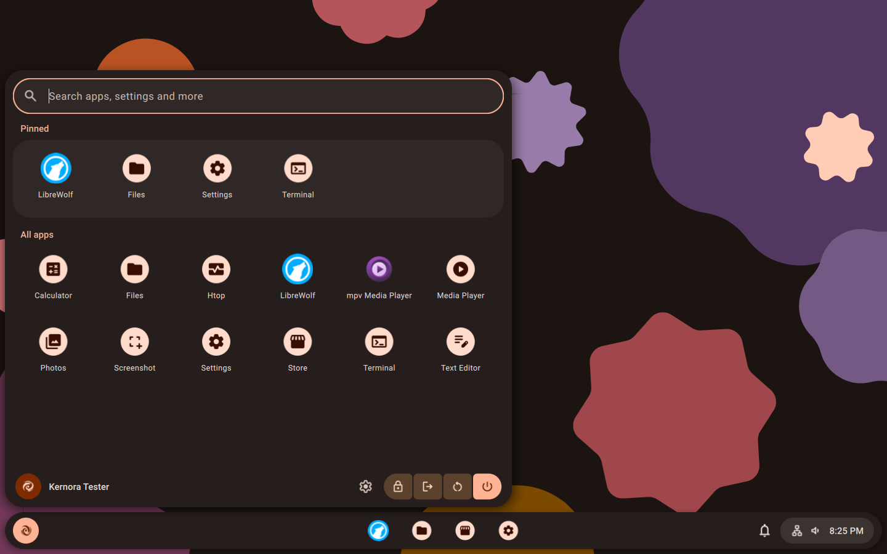
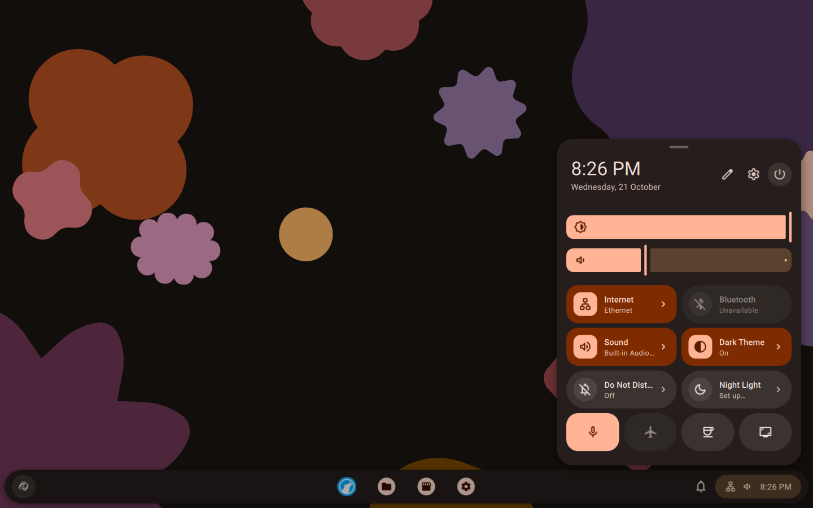
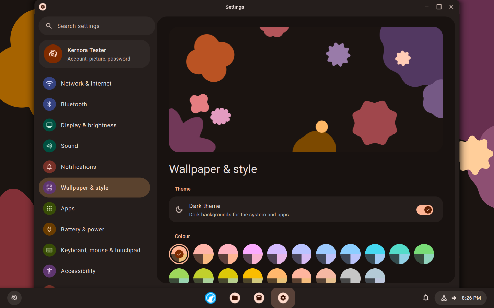
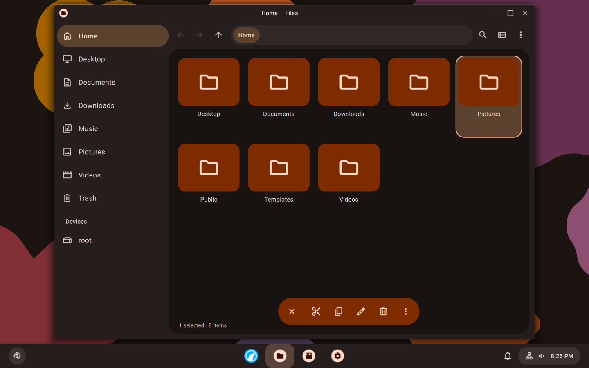
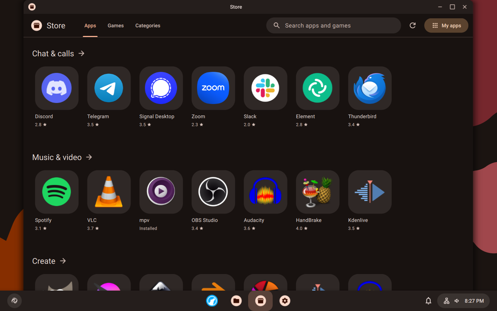
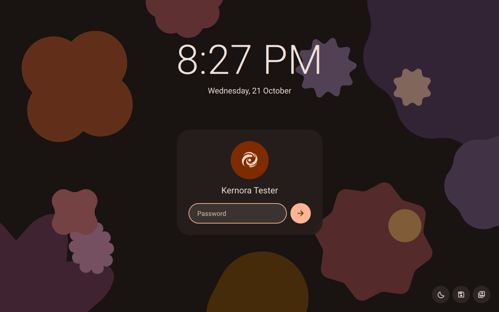

# Kernora OS

[](https://discord.gg/TvxBPButVu)

Kernora is a desktop Linux distro based on Debian 13 (trixie). It runs KDE
Plasma 6, but with its own shell, apps and themes, all done in Material 3
style. Basically I wanted Plasma to look and feel like Material You, so I
made it.

This repo has everything to build the live ISO: Kernora's own packages, the
few Debian packages I patch, the image config, and the build scripts and
tests.

It's still early. Test builds are in [Releases](https://github.com/commywork9282-dotcom/Kernora-OS-/releases).
Packages are signed with a dev key for now, there's no release key yet.

Got a bug, a question or just wanna show your setup? Come hang out on
[Discord](https://discord.gg/TvxBPButVu), I post updates there and most of
the testers are there too. Issues here work as well.

If an older image left your installed system on a black screen, see
[boot recovery](docs/BOOT-RECOVERY.md). Current images and updates fix the
root folder ownership that caused it.

## Screenshots

Taken in a VM with the default colour and dark theme.

<table>
  <tr>
    <td></td>
    <td></td>
  </tr>
  <tr>
    <td align="center">App launcher</td>
    <td align="center">Quick settings</td>
  </tr>
  <tr>
    <td></td>
    <td></td>
  </tr>
  <tr>
    <td align="center">Settings</td>
    <td align="center">Files, with the selection toolbar</td>
  </tr>
  <tr>
    <td></td>
    <td></td>
  </tr>
  <tr>
    <td align="center">Store</td>
    <td align="center">Lock screen</td>
  </tr>
</table>

## What's in it

- Debian 13.7 from a fixed snapshot (2026-10-15), Linux 6.12, KDE Plasma 6.3
- a Kernora shell on top of Plasma: see-through floating panel (you can make
  it solid in Settings), app launcher, quick settings, notifications, lock
  screen, Alt+Tab and power menu. Every colour comes from one seed colour,
  `#ff6a1e`, and you can switch the whole look between Material Design 1, 2
  and 3 in Settings
- Kernora apps instead of the KDE ones: Settings, Store, Files, Text Editor,
  Photos, Media Player, Calculator, Screenshot, Terminal (Alacritty) and
  Welcome, plus a file chooser every app uses
- Store for apps and games from Flathub and Debian, so you don't need the
  terminal to install stuff (see [docs/STORE.md](docs/STORE.md))
- Material 3 desktop widgets and live wallpapers: Shapes, Rhythm, Starfall
  and Pastel
- the usual terminal tools out of the box: git, curl, htop, fastfetch and co
- LibreWolf as the browser. It's not in Debian, so the build installs one
  pinned version from the LibreWolf repo and installed systems update from
  there
- NVIDIA drivers install by themselves on PCs with an NVIDIA card
  ([docs/DRIVERS.md](docs/DRIVERS.md))
- Quick Share with Android phones: send and receive files over Wi-Fi, no
  app needed on the phone ([docs/QUICKSHARE.md](docs/QUICKSHARE.md))
- Android apps (demo channel for now): turn Android on in Settings, then
  open any .apk file. Each app gets its own window
  ([docs/ANDROID.md](docs/ANDROID.md))
- Calamares as the installer, restyled to match
- English and Russian. You pick the live session language in the boot menu
- updates: Debian security updates (kernel too) and LibreWolf install by
  themselves once a day. Debian point releases and Kernora's own packages
  show up in Settings > Updates. More in [docs/UPDATES.md](docs/UPDATES.md)

KDE's standalone apps (Dolphin, Konsole, Kate, Discover, Spectacle and so on)
are left out, the list is in `configs/live/excluded-packages.txt`.

## Building

You need a Debian-based machine with:

- unprivileged user namespaces and subuid/subgid mappings (nothing builds as
  root)
- `apt-get`, `dpkg-dev`, `curl`, `gpg` and `gpgv`
- `grub-common`, `grub-pc-bin`, `grub-efi-amd64-bin`, `xorriso`,
  `squashfs-tools` and `xz-utils` for the ISO
- `qemu-system-x86` for the boot tests
- around 10 GB free disk space

Your host's APT setup isn't touched. Keyrings, tools and caches all live in
the working tree.

Build the ISO and check it boots in QEMU (BIOS and UEFI):

```sh
make iso-smoke
```

You get `out/iso/kernora-1-ember-live-amd64.iso` with a `.sha256` file next
to it. `make iso` builds it without the boot tests.

You can also run steps one by one, like `make local-archive` (all packages
plus the signed APT archive) or `make live-rootfs`. The `Makefile` has the
full list.

The ISO build puts its squashfs in `_build/`. If your disk is tight, set
`KERNORA_SCRATCH_DIR` (to `/tmp` for example) to put it somewhere else, the
finished ISO still lands in `out/iso/`.

Builds are reproducible: the Debian snapshot, tool versions and every
downloaded file are pinned by SHA-256, and archives get a fixed file order,
times and owners. Build output (`_build/`, `_cache/`, `out/`, `_state/`)
stays out of Git.

To try shell or app changes without rebuilding the whole ISO,
`scripts/preview-desktop` boots the desktop in QEMU and syncs your files
into it.

## Layout

- `packages/native/`: Kernora's own packages (`kernora-base`,
  `kernora-archive`, `kernora-desktop`, `kernora-apps`,
  `kernora-quickshare`)
- `packages/derived/`: patched Debian packages (`base-files`, Calamares and
  `polkit-kde-agent-1`)
- `configs/`: upstream pins, the live image and the system identity
- `scripts/`: build steps. `tests/`: checks for every package and the image
- `docs/`: how it all works. Start with
  [docs/ARCHITECTURE.md](docs/ARCHITECTURE.md), then
  [docs/DESKTOP.md](docs/DESKTOP.md) for the shell and design system,
  [docs/APPS.md](docs/APPS.md) for the apps,
  [docs/UPDATES.md](docs/UPDATES.md) for updates and publishing them,
  [docs/DRIVERS.md](docs/DRIVERS.md) for the graphics drivers,
  [docs/QUICKSHARE.md](docs/QUICKSHARE.md) for Quick Share and
  [docs/ANDROID.md](docs/ANDROID.md) for Android apps

## License

Kernora OS is under the GNU GPL version 3 (`LICENSE`). Kernora's own files
are GPL-2.0-or-later. `NOTICE` lists the parts that come from other people
and their licenses.
